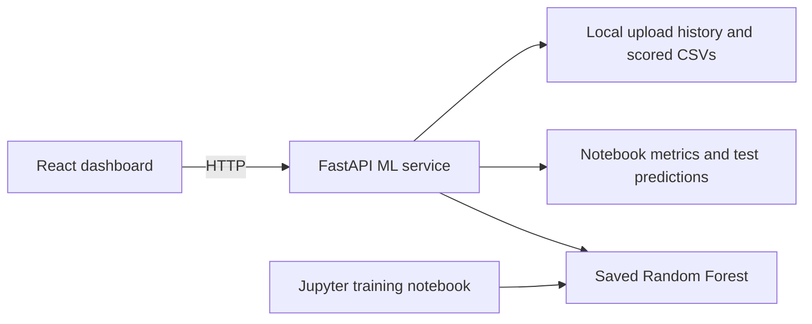

<div align="center">

# 🛡️ Fraud Detection for Imbalanced Data

**A practical, file-upload fraud analytics demo powered by a notebook-trained Random Forest.**

[](https://www.python.org/)
[](https://fastapi.tiangolo.com/)
[](https://react.dev/)
[](#)

</div>

> **Project scope:** This is an educational/demo application. It scores uploaded
> CSV batches; it does not connect to banks, stream live payments, or confirm
> fraud without ground-truth labels and human review.

## What it does

- Shows notebook baseline results and class-imbalance metrics.
- Scores a compatible CSV and downloads a copy with fraud probabilities and
  predicted classes.
- Updates the dashboard as soon as scoring finishes.
- Keeps local upload history so earlier results can be reopened and downloaded.
- Shows per-row predictions and, when supplied, actual labels for evaluation.
- Includes single-transaction scoring, model comparison, and feature importance.

## How it fits together



The dashboard's baseline charts use saved notebook outputs. Upload charts use
the selected uploaded file. Each uploaded row is one transaction record and is
scored independently.

## Model input requirements

The saved model was trained using the ULB credit-card dataset's anonymized
features. A scoreable CSV must include these **numeric** columns:

| Required columns | Optional label |
| --- | --- |
| `Time`, `V1`–`V28`, `Amount` | `Class` or `Actual_Class` |

Column order and casing do not matter. Extra columns are preserved in the
scored output. An optional binary label is used only to calculate evaluation
metrics; it is never a model input.

**A different dataset schema needs a different trained model or explicitly
validated preprocessing.** Renaming `merchant`, `location`, or other unrelated
fields to `V1`–`V28` does not make the values compatible.

## Get the dataset

The original ULB dataset is available from
[Kaggle — Credit Card Fraud Detection](https://www.kaggle.com/datasets/mlg-ulb/creditcardfraud).
Download `creditcard.csv` and follow Kaggle's dataset terms. For the notebook,
place it here and rename it:

```text
ml-service/data/creditcard_transactions.csv
```

The full training CSV is intentionally **not stored in this Git repository**:
it is about 144 MB, exceeding GitHub's 100 MB per-file limit. The application
can run its saved-model demo without that training CSV; it is needed to rerun
the notebook's data exploration and training cells.

For a quick compatible upload, the repository includes
`ml-service/outputs/test_predictions_sample.csv`. The larger
`ml-service/outputs/test_predictions.csv` is a held-out test set, not an
independent Kaggle dataset.

## Run locally (Windows PowerShell)

Open two terminals in the project folder.

### 1. Start the ML API

```powershell
cd C:\FraudDetection\ml-service
python -m venv .venv
.\.venv\Scripts\Activate.ps1
python -m pip install -r requirements.txt
python -m uvicorn app.main:app --reload --host 127.0.0.1 --port 8000
```

Check `http://127.0.0.1:8000/health`; API documentation is at
`http://127.0.0.1:8000/docs`.

### 2. Start the web app

```powershell
cd C:\FraudDetection\frontend
npm install
npm run dev
```

Open the local URL printed by Vite (normally `http://localhost:5173`). Keep the
ML API terminal running.

## Upload and review results

1. Open **Score a CSV dataset** and choose a compatible CSV.
2. Select **Score dataset and download results**.
3. The app downloads the scored CSV and updates the dashboard.
4. Open **Uploaded results** for row-level predictions, or **Upload history**
   to revisit and download a previous scored file.

Scored files and history metadata are stored locally under
`ml-service/outputs/uploads/`. They survive page refreshes and API restarts,
but are not automatically synchronized across machines or stored in MySQL.

## Project layout

```text
backend/                  Optional Spring Boot API
bigdata/spark/            Spark data-processing examples
data/schema.sql           MySQL schema
docs/                     Project plan and analysis notes
frontend/                 React + Vite dashboard
ml-service/app/           FastAPI prediction and upload endpoints
ml-service/models/        Saved Random Forest model
ml-service/notebooks/     Training and evaluation notebook
ml-service/outputs/       Saved test predictions and model metrics
```

## API endpoints

| Method | Endpoint | Purpose |
| --- | --- | --- |
| `GET` | `/health` | Check API/model health |
| `GET` | `/api/dashboard` | Notebook baseline analytics |
| `GET` | `/api/model-comparison` | Notebook model comparison |
| `GET` | `/api/transactions` | Page through baseline rows |
| `POST` | `/predict` | Score one transaction |
| `POST` | `/predict-batch` | Score a batch of transactions |
| `POST` | `/predict-csv` | Score CSV contents sent as `text/csv` |
| `GET` | `/api/uploads/history` | List saved uploads |
| `GET` | `/api/uploads/{upload_id}/dashboard` | View a saved upload summary |
| `GET` | `/api/uploads/{upload_id}/transactions` | Page through saved upload rows |
| `GET` | `/api/uploads/{upload_id}/download` | Download a scored CSV |

The dashboard also uses `/api/uploads/current/dashboard` and
`/api/uploads/current/transactions` for the latest upload.

## Optional backend and production notes

The FastAPI service and frontend demo do not require MySQL or Spring Boot. The
Java backend and Spark examples are supporting project components and are not
required to score uploads. Configure database and JWT settings through
environment variables; do not put real credentials in source control.

This project is not production-ready for financial decisions. Validate model
performance on representative data, review flagged records, and add suitable
security, privacy, monitoring, and operational controls before any real-world
use.
